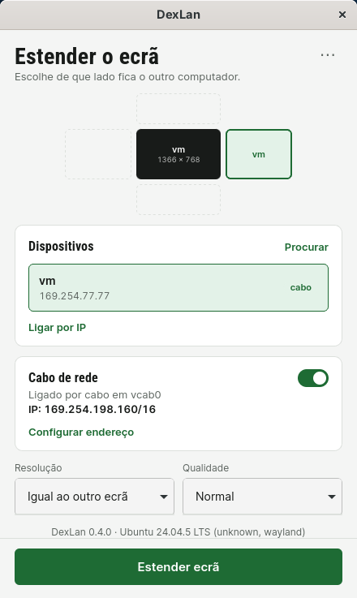

# DexLan

**D**esktop **ex**tended over **LAN**: usa outro computador Linux da rede como **ecrã estendido**.

O DexLan cria um ecrã virtual no teu desktop (o sistema vê-o como um monitor normal),
envia a imagem desse ecrã pela rede e o outro computador mostra-a em ecrã inteiro.
Arrastas janelas para lá como farias com um monitor ligado por cabo.



## Requisitos

- **Computador principal:** Linux com GNOME em Wayland (Ubuntu 22.04+, Fedora, Debian 12+...).
  Em X11 também funciona, em modo experimental.
- **Computador que serve de ecrã:** qualquer Linux com ambiente gráfico.
- Os dois na mesma rede, ou ligados directamente por um cabo de rede.

## Instalação

Nos dois computadores:

```bash
git clone https://github.com/henriquecondela-dev/DexLan.git
cd DexLan
./install.sh
```

O `install.sh` verifica o sistema e instala o que faltar com o gestor de pacotes da
distribuição (apt, dnf, pacman, zypper ou apk). Só precisa de internet para isso, na
primeira vez. Depois funciona sem internet.

## Como usar

1. No computador que vai servir de ecrã abre **DexLan Receiver**.
2. No computador principal abre **DexLan**, escolhe de que lado fica o outro ecrã,
   escolhe o dispositivo na lista e carrega em **Estender ecrã**.
3. Da primeira vez, escreve o código de 6 dígitos que aparece no outro computador.
4. Arrasta janelas para o novo ecrã. Ao parar, voltam todas para o ecrã principal.

Para o receiver abrir sozinho ao ligar o computador:

```bash
mkdir -p ~/.config/autostart
cp ~/.local/share/applications/dexlan-receiver.desktop ~/.config/autostart/
```

## Ligação por cabo

Com um cabo de rede directo entre os dois computadores a imagem fica mais estável e com
menos atraso. Não é preciso configurar nada no sistema: o DexLan cria um perfil
`DexLan-cabo` no NetworkManager quando detecta o cabo. O Wi-Fi continua a funcionar
ao mesmo tempo.

- **Automático:** cada lado escolhe um endereço `169.254.x.x`.
- **Manual:** defines o IP e a máscara (ex.: `192.168.50.1` e `192.168.50.2`, máscara
  `255.255.255.0`), na janela em *Cabo de rede > Configurar endereço* ou no terminal.

```bash
dexlan cable status
dexlan cable manual 192.168.50.1 255.255.255.0
dexlan cable auto
```

Se o cabo estiver ligado a um router, o DexLan não mexe na rede.

## Mudar o visual

A interface é HTML, CSS e JavaScript:

```
dexlan/ui/web/
├── comum/base.css     cores, fontes e componentes
├── comum/ponte.js     comunicação com o Python
├── comum/cabo.js      cartão do cabo de rede
├── host/              janela principal
└── receiver/          ecrã de espera do receiver
```

Podes abrir `host/index.html` ou `receiver/index.html` directamente no browser: aparecem
dados de exemplo para editares o visual sem correr o programa. Com `DEXLAN_DEV=1`, a
janela da aplicação permite abrir o inspector (botão direito > Inspecionar).

## Comandos

```bash
dexlan app                   # janela principal
dexlan receiver              # modo ecrã
dexlan host --connect IP     # sem janela
dexlan doctor                # verificar o sistema
dexlan setup                 # instalar dependências
dexlan cable status          # estado do cabo
dexlan cable manual IP MASK  # IP fixo no cabo
dexlan trust list            # dispositivos emparelhados
dexlan trust forget          # esquecer emparelhamentos
dexlan monitors              # listar monitores
dexlan uninstall --purge     # desinstalar tudo
```

## Desinstalar

```bash
./install.sh --uninstall           # remove o programa
./install.sh --uninstall --purge   # remove também definições, emparelhamentos e perfil do cabo
```

Também está no menu `⋯` da janela. Os pacotes do sistema (GStreamer, GTK) não são removidos.

## Estrutura

```
dexlan/
├── ecra/           ecrã virtual (GNOME/Mutter, X11)
├── ui/             janelas (Python + HTML/CSS/JS)
├── host.py         ligação, vídeo e reconexão do lado principal
├── receiver.py     lado do ecrã
├── cabo.py         ligação por cabo (NetworkManager)
├── video.py        pipelines GStreamer (H.264)
├── protocolo.py    mensagens entre os dois lados
├── seguranca.py    TLS, código de emparelhamento
├── descoberta.py   descoberta na rede
├── dependencias.py dependências por distribuição
└── desinstalar.py
testes/             python3 -m unittest discover -s testes
docs/               como funciona
```

## Estado

Versão 0.4. Funciona em GNOME Wayland (testado no Ubuntu 24.04). Ainda falta:
KDE e Sway, mais do que um ecrã virtual, áudio e baixar ainda mais o atraso.

Mais detalhes em [docs/como-funciona.md](docs/como-funciona.md).

## Licença

MIT
